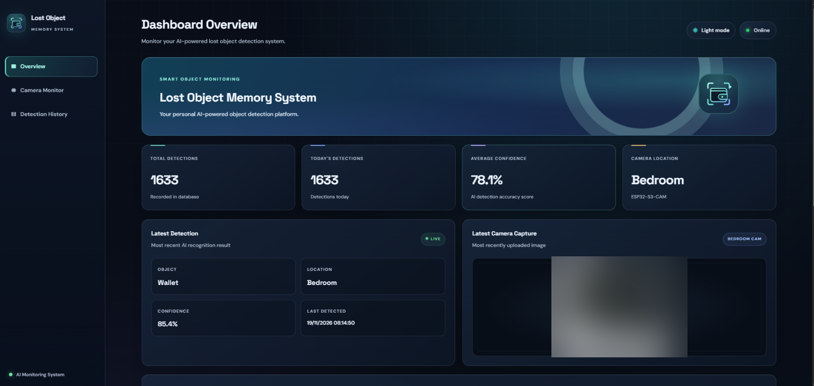
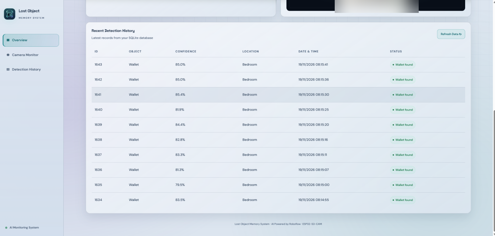
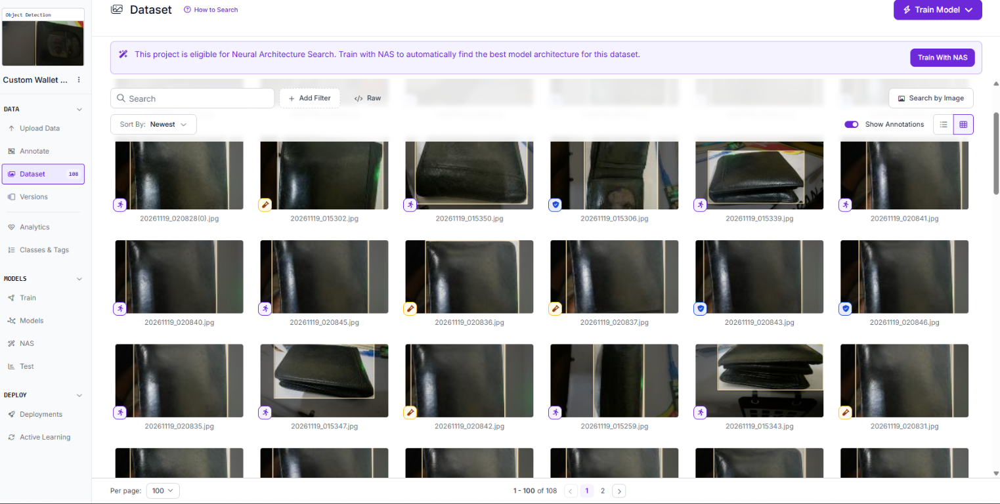

<p align="center">
  
</p>

<h1 align="center">Lost Object Memory System</h1>

<p align="center">
  A local camera-to-dashboard prototype that uses an ESP32-S3-N16R8, an OV3660 camera, and Roboflow to recognize a wallet and record where it was seen.
</p>

<p align="center">
  
</p>

<p align="center"><em>Dashboard in dark mode. The camera preview has been blurred for privacy.</em></p>

## Overview

The Lost Object Memory System is a local, single-camera prototype for helping someone remember where a wallet was last seen. An ESP32-S3-N16R8 board paired with an OV3660 camera sends an image to a Flask server. The server forwards it to a hosted Roboflow workflow, saves the result and image locally, and makes recent detections available to a browser dashboard.

The project's main focus is the end-to-end lost-object memory workflow: camera capture, wallet recognition, a timestamped history, and a simple view of the latest result. It is not a general object-search service or a hosted multi-user application.

## Project highlights

- **Camera-to-inference pipeline:** The ESP32-S3-N16R8 and OV3660 capture images that Flask sends to the hosted Roboflow workflow.
- **Focused recognition:** The current custom model is configured for wallet detection, with a confidence threshold to determine accepted predictions.
- **Local object memory:** Captured images and detection results are saved locally and surfaced in the dashboard's recent history.
- **Clear prototype scope:** This is a local, single-camera project; additional object datasets, models, and object-selection controls are planned.

## Dashboard

The dashboard includes a saved light/dark theme, live server status, detection totals, average confidence, the latest capture, and recent detection history. Values and new history rows transition smoothly when the data changes.

| Light mode | Recent detection history |
| --- | --- |
|  |  |

*The example screenshots use demonstration data. The camera photo has been blurred.*

## How it works

```mermaid
flowchart LR
    Camera[ESP32-S3-N16R8 + OV3660] -->|POST image| Upload[Flask /upload]
    Upload --> Inference[Roboflow hosted workflow]
    Inference --> Save[SQLite + local captured image]
    Save --> API[Flask dashboard API]
    API -->|polls every 3 seconds| UI[Browser dashboard]

    classDef device fill:#e0f2fe,stroke:#0284c7,color:#0c4a6e,stroke-width:2px
    classDef server fill:#dcfce7,stroke:#16a34a,color:#14532d,stroke-width:2px
    classDef model fill:#f3e8ff,stroke:#9333ea,color:#581c87,stroke-width:2px
    classDef storage fill:#fef3c7,stroke:#d97706,color:#78350f,stroke-width:2px
    classDef dashboard fill:#ffe4e6,stroke:#e11d48,color:#881337,stroke-width:2px

    class Camera device
    class Upload,API server
    class Inference model
    class Save storage
    class UI dashboard
```



1. The camera uploads a JPEG image to `/upload`.
2. Flask saves the image in `Captured_Images/` and sends it to the configured Roboflow workflow.
3. The server selects the best wallet prediction at or above the configured confidence threshold and stores the result in SQLite.
4. The dashboard requests `/api/dashboard` every three seconds and displays the latest capture, summary statistics, and recent records.

## Hardware

| Component | Role in the project |
| --- | --- |
| **ESP32-S3-N16R8** | Camera controller and Wi-Fi device. The firmware captures an image and sends it to the local Flask server's `/upload` endpoint. |
| **OV3660** | Camera sensor used to capture the wallet scene that is passed to the detection workflow. |

The main camera sketch is [`OV3660_Camera_Test.ino.ino`](ESP32_Codes/OV3660_Camera_Test.ino.ino); additional ESP32 test and backup sketches are in [`ESP32_Codes/`](ESP32_Codes/).

## Custom Wallet Detection model

The project uses a hosted Roboflow workflow named `custom-wallet-detection`. The screenshot below shows the wallet image dataset and annotated examples used with the custom model.

<p align="center">
  
</p>

When the ESP32-S3-N16R8 with its OV3660 camera posts an image to Flask's `/upload` route, Flask saves the image locally and sends it to the Roboflow workflow. The server reads `ROBOFLOW_API_KEY` from its environment and sends it in the request header; the key is not included in this repository. A result counts as a wallet detection only when the predicted class is `wallet` and its confidence is at least `0.50` (the current `CONFIDENCE_THRESHOLD`). Flask saves the detection details and raw Roboflow response in `Database/lost_objects.db`, while the original uploaded image remains in `Captured_Images/`. The dashboard then reads the saved detection history through Flask's API.

## Future development

The current prototype focuses on detecting one object: a wallet, using one hosted custom model. Limited hardware resources and the small amount of labeled training data currently available make this focused approach practical for the project.

As the project grows, we plan to:

- Build labeled datasets for additional object categories and use them to train and test new models.
- Add a dashboard control to select one object or multiple supported objects to detect.
- Extend the inference workflow to use the selected objects while continuing to record results in the detection history.

## Built with

- **Python 3.11** and **Flask** for the local web server and JSON endpoints
- **Roboflow Inference SDK** for hosted wallet detection
- **SQLite** for persistent detection history
- **HTML, CSS, and vanilla JavaScript** for the responsive dashboard, themes, and transitions
- **ESP32-S3-N16R8** board and **OV3660** camera for image capture and upload

The Roboflow workflow is managed separately and is not included in this repository. Training datasets, model weights, captured camera images, and local database files are also intentionally excluded.

## Project layout:

```text
Lost-Object-Memory-System/
├── ESP32_Codes/              # ESP32 camera, test, and backup sketches
├── Python_Server/
│   ├── app.py                 # Flask server, image upload, inference, and APIs
│   └── database.py            # Optional standalone database initializer
├── Website/
│   ├── templates/index.html   # Dashboard page
│   └── static/
│       ├── css/style.css      # Responsive light/dark themes and animations
│       ├── js/dashboard.js    # Dashboard polling and rendering
│       └── img/brand-mark.svg
├── docs/screenshots/          # Dashboard and Roboflow dataset screenshots
├── requirements.txt
└── README.md
```

## Run locally on Windows

### 1. Install the requirements

Open Command Prompt in the project folder:

```bat
cd /d D:\path\to\Lost-Object-Memory-System\Python_Server
py -3.11 -m venv .venv
.venv\Scripts\activate
python -m pip install -r ..\requirements.txt
```

### 2. Configure Roboflow

Set the API key in the same Command Prompt window used to run Flask:

```bat
set ROBOFLOW_API_KEY=YOUR_ROBOFLOW_API_KEY
```

Do not put a real key in source code or commit it to GitHub. The server reads it from the `ROBOFLOW_API_KEY` environment variable. Confirm that the workspace and workflow configured near the top of `Python_Server/app.py` are available to your Roboflow account.

### 3. Start the server and open the dashboard

```bat
python app.py
```

Then open [http://127.0.0.1:5000/](http://127.0.0.1:5000/) in a browser. Keep the terminal open while using the dashboard.

The server creates `Database/lost_objects.db` and `Captured_Images/` as needed. The dashboard uses the database; its theme preference is stored in the browser.

## Configuration

The current single-camera defaults are defined in `Python_Server/app.py`:

- `LOCATION` — location label shown in the dashboard and saved with each detection
- `CAMERA_ID` — camera label
- `CONFIDENCE_THRESHOLD` — minimum confidence for a prediction to count as a wallet detection
- `WORKSPACE_NAME` and `WORKFLOW_ID` — hosted Roboflow workflow to call

Keep the API key in the environment rather than in these settings.

## API routes

| Route | Purpose |
| --- | --- |
| `GET /` | Serve the dashboard |
| `GET /status` | Report server and configuration status |
| `POST /upload` | Receive and process a camera image |
| `GET /api/dashboard` | Return dashboard statistics and recent detections |
| `GET /api/detections` | Return recent detection records |
| `GET /api/latest` | Return the newest detection |
| `GET /api/stats` | Return summary statistics |
| `GET /images/<filename>` | Serve a locally saved camera image |

## Privacy and repository contents

This repository contains application source and documentation screenshots, not the local detection database. `.gitignore` excludes local virtual environments, API-key files, captured images, SQLite databases, datasets, model weights, and local test artifacts.

Before sharing screenshots or changing the repository's visibility, check that they do not reveal private camera images or personal information. The Roboflow screenshot contains example wallet images from the dataset. Never commit your Roboflow API key.
