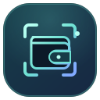
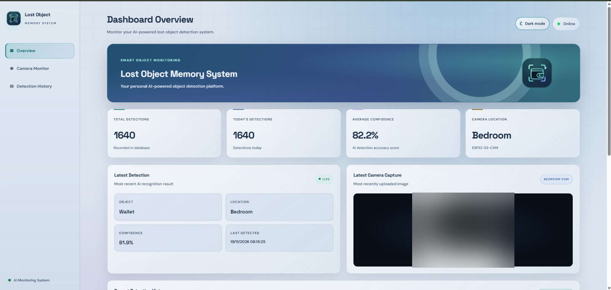
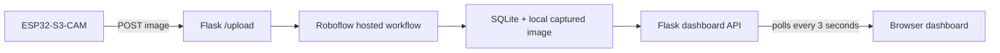

<p align="center">
  
</p>

<h1 align="center">Lost Object Memory System</h1>

<p align="center">
  A camera-assisted dashboard that records when a wallet is detected and where it was seen.
</p>

<p align="center">
  
</p>

<p align="center"><em>Dashboard in dark mode. The camera preview has been blurred for privacy.</em></p>

## Overview

The Lost Object Memory System is a local, single-camera prototype for helping someone remember where a wallet was last seen. An ESP32-S3-CAM sends an image to a Flask server. The server forwards it to a hosted Roboflow workflow, saves the result and image locally, and makes recent detections available to a browser dashboard.

The project's main focus is the end-to-end lost-object memory workflow: camera capture, wallet recognition, a timestamped history, and a simple view of the latest result. It is not a general object-search service or a hosted multi-user application.

## Dashboard

The dashboard includes a saved light/dark theme, live server status, detection totals, average confidence, the latest capture, and recent detection history. Values and new history rows transition smoothly when the data changes.

| Light mode | Recent detection history |
| --- | --- |
|  |  |

*The example screenshots use demonstration data. The camera photo has been blurred.*

## How it works



1. The camera uploads a JPEG image to `/upload`.
2. Flask saves the image in `Captured_Images/` and sends it to the configured Roboflow workflow.
3. The server selects the best wallet prediction at or above the configured confidence threshold and stores the result in SQLite.
4. The dashboard requests `/api/dashboard` every three seconds and displays the latest capture, summary statistics, and recent records.

## Built with

- **Python 3.11** and **Flask** for the local web server and JSON endpoints
- **Roboflow Inference SDK** for hosted wallet detection
- **SQLite** for persistent detection history
- **HTML, CSS, and vanilla JavaScript** for the responsive dashboard, themes, and transitions
- **ESP32-S3-CAM** as the image-capture device

The camera firmware and Roboflow workflow are managed separately and are not included in this repository. Training datasets, model weights, captured camera images, and local database files are also intentionally excluded.

## Project layout

```text
Lost-Object-Memory-System/
├── Python_Server/
│   ├── app.py                 # Flask server, image upload, inference, and APIs
│   └── database.py            # Optional standalone database initializer
├── Website/
│   ├── templates/index.html   # Dashboard page
│   └── static/
│       ├── css/style.css      # Responsive light/dark themes and animations
│       ├── js/dashboard.js    # Dashboard polling and rendering
│       └── img/brand-mark.svg
├── docs/screenshots/          # Privacy-blurred dashboard screenshots
├── requirements.txt
└── README.md
```

## Run locally on Windows

### 1. Install the requirements

Open Command Prompt in the project folder:

```bat
cd /d D:\path\to\Lost-Object-Memory-System\Python_Server
py -3.11 -m venv .venv
.venv\Scripts\activate
python -m pip install -r ..\requirements.txt
```

### 2. Configure Roboflow

Set the API key in the same Command Prompt window used to run Flask:

```bat
set ROBOFLOW_API_KEY=YOUR_ROBOFLOW_API_KEY
```

Do not put a real key in source code or commit it to GitHub. The server reads it from the `ROBOFLOW_API_KEY` environment variable. Confirm that the workspace and workflow configured near the top of `Python_Server/app.py` are available to your Roboflow account.

### 3. Start the server and open the dashboard

```bat
python app.py
```

Then open [http://127.0.0.1:5000/](http://127.0.0.1:5000/) in a browser. Keep the terminal open while using the dashboard.

The server creates `Database/lost_objects.db` and `Captured_Images/` as needed. The dashboard uses the database; its theme preference is stored in the browser.

## Configuration

The current single-camera defaults are defined in `Python_Server/app.py`:

- `LOCATION` — location label shown in the dashboard and saved with each detection
- `CAMERA_ID` — camera label
- `CONFIDENCE_THRESHOLD` — minimum confidence for a prediction to count as a wallet detection
- `WORKSPACE_NAME` and `WORKFLOW_ID` — hosted Roboflow workflow to call

Keep the API key in the environment rather than in these settings.

## API routes

| Route | Purpose |
| --- | --- |
| `GET /` | Serve the dashboard |
| `GET /status` | Report server and configuration status |
| `POST /upload` | Receive and process a camera image |
| `GET /api/dashboard` | Return dashboard statistics and recent detections |
| `GET /api/detections` | Return recent detection records |
| `GET /api/latest` | Return the newest detection |
| `GET /api/stats` | Return summary statistics |
| `GET /images/<filename>` | Serve a locally saved camera image |

## Privacy and repository contents

This repository contains application source and blurred dashboard screenshots, not personal detection records. `.gitignore` excludes local virtual environments, API-key files, captured images, SQLite databases, datasets, model weights, and local test artifacts.

Before sharing screenshots or changing the repository's visibility, check that they do not reveal private camera images or personal information. Never commit your Roboflow API key.
